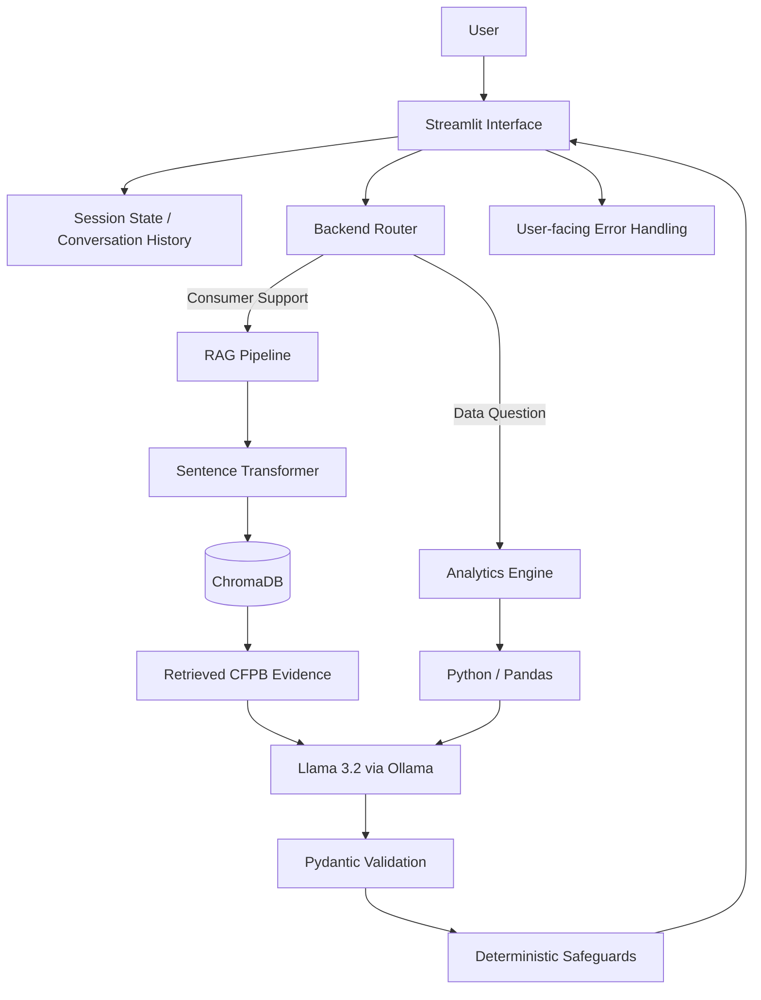

# CFPB Consumer Complaint Intelligence & Support Assistant

## Project Overview

The CFPB Consumer Complaint Intelligence & Support Assistant is a consumer-finance support and analytics application.

The project addresses two related problems:

1. helping users understand consumer-finance complaints using official Consumer Financial Protection Bureau (CFPB) information; and
2. helping users explore patterns in millions of published CFPB complaint records.

The system combines:

- Retrieval-Augmented Generation (RAG);
- a locally hosted Large Language Model;
- semantic document retrieval;
- structured CFPB complaint data;
- deterministic Python analytics;
- schema validation;
- multi-turn conversation support;
- Streamlit; and
- Docker containerization.

The system deliberately does not use the language model for every task. Natural-language interpretation and explanation are handled by the LLM, while numerical analysis is performed using deterministic Python and Pandas operations.

The application is intended as an informational and decision-support tool. It does not provide legal, financial or regulatory advice.

---

## Problem Statement

Consumers frequently experience problems involving financial products such as credit reporting, debt collection, bank accounts, loans and credit cards.

Although the CFPB provides official information and maintains a large public Consumer Complaint Database, users may still find it difficult to:

- locate relevant guidance;
- understand complaint procedures;
- interpret financial complaint terminology;
- identify patterns in millions of complaint records; and
- determine what practical next step may be appropriate.

The project addresses this problem through a hybrid system that combines official CFPB guidance with structured complaint analytics.

Instead of presenting users with large documents or raw datasets, the application allows them to ask questions in ordinary language and routes each request to the most appropriate processing path.

---

## Intended Users and Why AI Is Appropriate

The system is intended for three main user groups.

**Consumers** can describe a financial complaint in natural language and receive a concise explanation grounded in relevant CFPB information.

**Customer-support, compliance or consumer-relations staff** can use the system to locate relevant guidance more quickly and identify situations that require further review.

**Analysts and researchers** can ask questions about complaint patterns without manually examining millions of individual records.

An AI-assisted approach is appropriate because consumer complaints are often expressed informally, with incomplete terminology or without knowledge of official CFPB product categories.

The language model helps interpret these questions and convert retrieved or computed information into understandable responses.

However, the system does not rely on the LLM for tasks that deterministic software can perform more reliably.

For example:

```text
Natural-language understanding    → Llama 3.2
Document discovery                → Semantic retrieval
Numerical calculations            → Python / Pandas
Structured-output validity        → Pydantic
Safety and predictable behaviour  → Deterministic safeguards
```

This separation improves reliability and makes the system easier to explain and test.

---

## Human Review and Usefulness Criteria

The system is designed to request or recommend human review when:

- relevant CFPB evidence cannot be retrieved;
- the request is ambiguous, unsupported or outside the system's intended domain;
- the available evidence is insufficient to support a reliable recommendation; or
- the situation requires professional legal, financial or regulatory judgement.

The usefulness of the application is evaluated using measurable system behaviour rather than subjective impressions alone.

The formal evaluation checks whether:

- requests are routed to the correct processing path;
- structured outputs remain valid;
- evidence is used appropriately;
- unsupported claims are avoided;
- analytics results are calculated correctly; and
- human review is triggered when appropriate.

The final 15-case evaluation achieved:

| Metric | Result |
|---|---:|
| Test cases | 15 |
| Passed | 15 |
| Failed | 0 |
| Overall pass rate | 100% |
| Route accuracy | 100% |
| Structured output validity | 100% |

These results apply to the project's defined evaluation set and should not be interpreted as a guarantee of perfect performance on every possible real-world query.

---

## Main Capabilities

The application provides two primary capabilities.

### 1. Consumer Complaint Support

Users can describe a consumer-finance problem in natural language.

The system:

1. interprets the user's request;
2. determines whether the request belongs to the support or analytics workflow;
3. retrieves relevant information from official CFPB documents;
4. classifies the complaint into a CFPB product category;
5. generates a grounded summary;
6. provides a practical recommended action;
7. indicates whether supporting evidence was found; and
8. flags cases that may require human review.

Example:

> There is an account on my credit report that is not mine. What should I do?

The application retrieves relevant CFPB guidance before generating the response rather than relying only on the model's pre-trained knowledge.

---

### 2. Complaint Data Analytics

Users can ask statistical questions about CFPB complaint data.

Examples include:

> How many complaints were published in 2025?

> Which product had the most complaints?

> Which month recorded the highest number of complaints?

> What percentage of complaints received timely responses?

Analytical calculations are performed using deterministic Python and Pandas operations.

The language model is not asked to calculate the underlying statistics. It is used only to explain the already-computed result in natural language.

This reduces the risk of numerical hallucination.

---

## Dataset

The project uses the official **CFPB Consumer Complaint Database**.

The original raw dataset contained millions of records and was approximately 5.4 GB.

For this project, complaints published in the CFPB database for **2025** were processed.

### 2025 Dataset Summary

| Metric | Value |
|---|---:|
| Published complaints | 5,442,951 |
| Development sample | 108,809 |
| Financial products | 11 |
| Unique issues | 90 |
| Companies | 3,968 |
| Timely responses | 99.55% |
| Highest complaint month | October 2025 |
| October complaints | 519,784 |

The structured statistical analyses use aggregated results derived from the full **5,442,951 published complaint records**.

The 108,809-record sample is used as a manageable development and inspection subset.

The analysis therefore distinguishes between:

```text
Full 2025 published CFPB data
        ↓
Deterministic aggregation
        ↓
Analytical CSV outputs
```

and:

```text
108,809-record deterministic sample
        ↓
Development and inspection
```

---

## Knowledge Base

The Retrieval-Augmented Generation component uses official CFPB documents stored in:

```text
data/documents/
```

The knowledge base includes CFPB information relating to:

- consumer complaint procedures;
- company complaint handling;
- credit report disputes;
- debt collection;
- suspicious account activity; and
- the CFPB 2025 Consumer Response Annual Report.

Documents are processed by:

```text
build_knowledge_base.py
```

The ingestion pipeline performs:

```text
PDF documents
      ↓
Text extraction
      ↓
Text cleaning
      ↓
Chunking
      ↓
Metadata assignment
      ↓
Sentence Transformer embeddings
      ↓
ChromaDB vector storage
```

The current knowledge base contains approximately **252 document chunks**.

Metadata such as source document and page information is retained so that retrieved evidence can be traced back to its origin.

---

## Retrieval-Augmented Generation Design

The system uses the `all-MiniLM-L6-v2` Sentence Transformer model for document embeddings.

ChromaDB is used as the local vector database.

For a consumer-support query:

```text
User Question
      ↓
Query Embedding
      ↓
ChromaDB Similarity Search
      ↓
Relevant CFPB Chunks
      ↓
Grounded Prompt
      ↓
Llama 3.2
      ↓
Pydantic Validation
      ↓
Deterministic Safeguards
      ↓
Final Response
```

Retrieval thresholds are used to prevent weak or irrelevant evidence from being treated as reliable CFPB guidance.

### Why Retrieval Is Used

Placing every CFPB document directly into every prompt would introduce large amounts of irrelevant information and would make the system harder to scale and control.

Retrieval is preferable because it:

- selects only information relevant to the current question;
- reduces unnecessary prompt context;
- makes responses easier to ground in identifiable source material;
- improves scalability as more documents are added; and
- allows the system to reject weak retrieval results instead of pretending that supporting evidence exists.

The language model therefore receives only the most relevant retrieved context rather than the entire document collection.

---

## System Architecture



The architecture uses a controlled routing layer rather than allowing the LLM to perform every operation.

The two main execution paths are:

```text
Consumer-support question
        ↓
Retrieval
        ↓
Grounded LLM interpretation
        ↓
Validation and safeguards
```

and:

```text
Analytics question
        ↓
Deterministic Python calculation
        ↓
Optional natural-language explanation
```

Conversation state is maintained in Streamlit session state for the duration of the current user session.

Persistent knowledge is stored in ChromaDB.

The Llama 3.2 model runs through Ollama as an external local service.

---

## Technology Stack

### Application

- Python 3.11
- Streamlit

### Large Language Model

- Llama 3.2
- Ollama

### Retrieval

- ChromaDB
- Sentence Transformers
- `all-MiniLM-L6-v2`

### Data Processing

- Pandas
- NumPy

### Document Processing

- PyPDF

### Validation

- Pydantic

### Deployment

- Docker
- Docker Compose

---

## Prompt Engineering

Three initial prompt variants were evaluated.

### Variant A – Basic Prompt

A minimal structured prompt providing general instructions.

### Variant B – Strict Grounding Prompt

A stricter prompt emphasizing evidence use and reduced hallucination.

### Variant C – Evidence-Aware Prompt

A balanced prompt emphasizing:

- CFPB evidence;
- uncertainty;
- complaint classification;
- factual summaries;
- practical actions;
- human review; and
- controlled verbosity.

Variant C produced the strongest overall performance and was selected as the final prompt.

### Initial Prompt Evaluation

| Prompt | Product Accuracy | Structured Validity | Human Review Consistency |
|---|---:|---:|---:|
| A – Basic | 60.0% | 100% | 93.3% |
| B – Strict Grounding | 73.3% | 100% | 100% |
| C – Evidence Aware | 80.0% | 100% | 100% |

Additional prompt refinements were tested but did not consistently improve performance.

This demonstrated an important engineering lesson: adding more prompt instructions did not automatically improve the behaviour of the local model.

Some predictable safety, routing and fallback behaviours were therefore moved from prompting into deterministic Python logic.

The detailed experiment outputs are retained in:

```text
evaluation/prompt_experiments/
evaluation/prompt_refinement/
evaluation/prompt_final/
```

---

## Structured Output

Consumer-support responses use a structured schema containing fields such as:

- product;
- summary;
- recommended action;
- evidence availability; and
- human review.

Pydantic validates the generated response before it is shown to the user.

This provides an explicit contract between the language model and the application.

If model output is malformed or incomplete, the application does not blindly trust it. Validation and application-level error handling prevent invalid structured responses from being treated as normal output.

---

## Deterministic Safeguards

The project intentionally separates tasks that should be performed by deterministic code from tasks suited to language models.

Examples include:

- complaint counting;
- percentages;
- highest and lowest values;
- monthly aggregation;
- product statistics;
- query routing;
- selected complaint classifications;
- evidence thresholds;
- unsupported calculation detection;
- fallback actions for selected high-risk cases; and
- prevention of unverified generated URLs.

This architecture reduces unnecessary dependence on the LLM.

A key design principle used throughout the project is:

```text
If software can compute or validate something reliably,
the LLM should not be responsible for guessing it.
```

---

## Multi-Turn Conversation

The Streamlit application maintains conversation history during a user session.

This allows contextual follow-up questions.

Example:

```text
User:
There is an account on my credit report that is not mine.

Assistant:
Provides grounded CFPB guidance.

User:
What should I do next?

Assistant:
Uses the previous conversation context when interpreting
the follow-up question.
```

Conversation history is stored in Streamlit session state.

The interface also provides a reset capability so that users can start a new conversation.

Conversation memory is session-based rather than permanently stored.

---

## Tool and Capability Design

The application performs useful operations beyond natural-language generation.

Two major capabilities are exposed through controlled application logic.

### CFPB Knowledge Retrieval

The support workflow:

```text
Question
  ↓
Semantic search
  ↓
Relevant CFPB evidence
  ↓
Grounded response
```

This capability is used when the user needs guidance derived from official CFPB documents.

### Deterministic Complaint Analytics

The analytics workflow:

```text
Question
  ↓
Intent / metric identification
  ↓
Approved Python / Pandas operation
  ↓
Computed result
  ↓
Natural-language explanation
```

This capability is used when the user asks for totals, percentages, rankings, monthly comparisons or other supported statistical analyses.

The backend router selects the appropriate path based on the request and conversation context.

---

## Reliability Evaluation

A formal evaluation suite was created with **15 test cases** covering:

- normal consumer-support requests;
- credit reporting;
- debt collection;
- bank-account problems;
- out-of-domain queries;
- ambiguous queries;
- invalid or gibberish inputs;
- adversarial requests;
- analytics queries;
- unsupported calculations;
- retrieval behaviour; and
- multi-turn interaction.

Final evaluation results:

| Metric | Result |
|---|---:|
| Test cases | 15 |
| Passed | 15 |
| Failed | 0 |
| Overall pass rate | 100% |
| Route accuracy | 100% |
| Structured output validity | 100% |

Evaluation files are stored in:

```text
evaluation/formal_evaluation/
```

The evaluation process was iterative.

Observed failures during development included routing edge cases, inconsistent prompt behaviour, weak fallback actions and an unverified generated-link issue.

These were addressed through targeted deterministic safeguards, improved routing logic and clearer application boundaries rather than continually increasing prompt complexity.

The evaluation history is documented in:

```text
evaluation/formal_evaluation/evaluation_history.md
```

---

## Unit Testing

Backend unit tests are located in:

```text
tests/test_backend.py
```

The current test suite contains **12 tests** covering functionality including:

- analytics routing;
- support routing;
- phrase matching;
- contextual follow-ups;
- complaint product detection;
- debt-collection safeguards;
- human-review behaviour;
- complaint totals;
- monthly analytics; and
- unsupported calculations.

Latest result:

```text
Ran 12 tests in 0.045s

OK
```

---

## Error and Uncertainty Handling

The application includes safeguards for:

- weak retrieval results;
- insufficient CFPB evidence;
- ambiguous questions;
- malformed LLM output;
- unsupported calculations;
- out-of-domain questions;
- adversarial requests;
- unavailable application services;
- unexpected request-processing errors; and
- cases requiring human review.

Request-processing errors are handled in the Streamlit application layer so that users receive a clear error message rather than an unhandled Python traceback.

The main application entry point also provides a top-level failure boundary for startup errors such as unavailable required data.

Application errors are logged to support diagnosis.

The system avoids claiming guaranteed consumer outcomes.

---

## Project Structure

```text
customer-service-ai-clean/
│
├── backend.py
├── streamlit_app.py
├── main.py
├── formal_evaluation.py
├── prepare_cfpb_data.py
├── build_knowledge_base.py
├── prompt_experiment.py
├── prompt_final_experiment.py
├── prompt_refinement_experiment.py
│
├── requirements.txt
├── Dockerfile
├── docker-compose.yml
├── .dockerignore
├── .env.example
├── .gitattributes
├── .gitignore
│
├── data/
│   ├── documents/
│   ├── processed/
│   ├── raw/             # local only, excluded from Git
│   └── chroma_db/       # generated locally, excluded from Git
│
├── docs/
│   └── architecture.md
│
├── evaluation/
│   ├── formal_evaluation/
│   ├── prompt_experiments/
│   ├── prompt_final/
│   └── prompt_refinement/
│
└── tests/
    └── test_backend.py
```

The large raw CFPB dataset and generated ChromaDB files are excluded from Git using `.gitignore`.

The repository retains the source documents, processed analytical files, evaluation evidence and scripts required to understand and reproduce the system.

---

## Installation

### 1. Clone the Repository

```bash
git clone https://github.com/oheneba-oa/Final_Project.git
cd Final_Project
```

### 2. Create or Activate a Python Environment

Python 3.11 is recommended.

Example using Conda:

```bash
conda create -n customer_service_ai python=3.11
conda activate customer_service_ai
```

### 3. Install Dependencies

```bash
python -m pip install -r requirements.txt
```

---

## Ollama Setup

Install Ollama and ensure the Llama 3.2 model is available.

```bash
ollama pull llama3.2
```

Check installed models:

```bash
ollama list
```

Ollama must be running before the application attempts to use the language model.

---

## Environment Configuration

Copy:

```text
.env.example
```

to:

```text
.env
```

Example configuration:

```text
OLLAMA_HOST=http://localhost:11434
HF_TOKEN=
```

The Hugging Face token is optional.

If supplied, it can be used for authenticated Hugging Face model downloads.

No secrets are stored directly in the source code.

---

## Building the Knowledge Base

The generated ChromaDB vector database is intentionally excluded from Git.

The CFPB source documents required to rebuild it are included in:

```text
data/documents/
```

To build the knowledge base manually, run:

```bash
python build_knowledge_base.py
```

This creates:

```text
data/chroma_db/
```

and indexes approximately **252 chunks**.

---

## Preparing CFPB Structured Data

The original multi-gigabyte CFPB CSV is intentionally excluded from the repository because of its size.

The processed analytical outputs required by the application are included in:

```text
data/processed/
```

To reproduce these files from the original CFPB complaint export, place the raw file at:

```text
data/raw/complaints.csv
```

Then run:

```bash
python prepare_cfpb_data.py
```

The generated analytical files are written to:

```text
data/processed/
```

---

## Running the Application Locally

Start Ollama first.

Then run:

```bash
streamlit run main.py
```

Open:

```text
http://localhost:8501
```

in a browser.

---

## Running the Tests

Run:

```bash
python -m unittest discover -s tests -v
```

The current suite contains 12 backend tests.

---

## Running the Formal Evaluation

Run:

```bash
python formal_evaluation.py
```

Evaluation outputs are saved in:

```text
evaluation/formal_evaluation/
```

The final validated evaluation contains 15 cases.

---

## Docker Deployment

The application has been successfully built and tested using Docker Desktop.

The Docker image uses CPU-only PyTorch to avoid unnecessary CUDA and NVIDIA dependencies.

### Build the Docker Image

```bash
docker compose build
```

### Start the Application

Ensure Ollama is running on the host computer.

Then run:

```bash
docker compose up
```

Open:

```text
http://localhost:8501
```

The container connects to the host Ollama service using:

```text
host.docker.internal
```

### Automatic Knowledge-Base Creation

The generated Chroma database does not need to be committed to the repository.

When the application container starts, it checks whether:

```text
data/chroma_db/chroma.sqlite3
```

exists.

If the database is missing, Docker automatically runs:

```bash
python build_knowledge_base.py
```

before starting Streamlit.

This behaviour was tested using a fresh Docker image with no existing Chroma database.

During the test, the container:

```text
Detected missing knowledge base
        ↓
Loaded the embedding model
        ↓
Processed all six CFPB documents
        ↓
Created 252 ChromaDB chunks
        ↓
Started the Streamlit application
```

This allows a fresh clone to rebuild the retrieval layer from the source documents included in the repository.

### Stop the Application

Press:

```text
Ctrl + C
```

and then run:

```bash
docker compose down
```

---

## Docker Architecture

```text
Windows Host
│
├── Ollama
│   └── Llama 3.2
│
└── Docker Desktop
    │
    └── Application Container
        ├── Python 3.11
        ├── Streamlit
        ├── Backend
        ├── Sentence Transformers
        ├── ChromaDB
        └── Processed CFPB Data
```

The language model is not packaged inside the application image.

Instead, the container communicates with the locally running Ollama service on the host.

This keeps the project architecture simpler and avoids unnecessarily large Docker images.

---

## Architecture Documentation

A more detailed engineering description is available in:

```text
docs/architecture.md
```

It documents:

- system components;
- request routing;
- RAG processing;
- structured-data analysis;
- application state;
- error handling;
- external services;
- persistence; and
- engineering rationale.

---

## Limitations

The current system has several limitations.

1. It uses a local Llama 3.2 model whose output can vary between runs.

2. The knowledge base is limited to the CFPB documents included in the project.

3. The system does not provide legal, financial or regulatory advice.

4. Complaint statistics currently focus on the processed 2025 dataset.

5. The application depends on a locally available Ollama service.

6. Retrieval quality depends on the coverage and relevance of the indexed CFPB documents.

7. Some safety and reliability behaviours require deterministic rules because prompt instructions alone are not always followed consistently by the model.

8. Conversation history is session-based and is not permanently stored between sessions.

9. The current application does not submit complaints to the CFPB or communicate directly with financial institutions.

---

## Future Improvements

Future versions could include:

- additional CFPB publications;
- support for multiple complaint years;
- automatic updating of CFPB complaint data;
- improved retrieval reranking;
- additional financial-product classifications;
- cloud-hosted language-model options;
- persistent user sessions;
- database-backed conversation storage;
- richer visual analytics dashboards;
- automated monitoring of model and retrieval performance; and
- carefully controlled integrations with external complaint-management systems.

---

## Responsible Use

The system is designed as an informational and decision-support tool.

It should not be used as a replacement for:

- qualified legal advice;
- professional financial advice;
- direct communication with a financial institution; or
- official CFPB guidance.

When evidence is incomplete or confidence is low, the application is designed to indicate uncertainty and recommend human review.

The application is therefore best understood as a tool for **finding, organizing, analysing and explaining information**, not as an autonomous decision-maker.

---

## Executive Summary

From a business perspective, the project demonstrates how AI can be combined with deterministic software to make a large public consumer-finance information environment easier to use.

The system does not simply generate answers.

It performs two controlled functions:

```text
Understand a consumer-finance problem
        ↓
Find relevant official guidance
        ↓
Explain a practical next step
```

and:

```text
Understand a data question
        ↓
Calculate the answer from structured CFPB data
        ↓
Explain the result clearly
```

The value of the system lies in reducing the effort required to move from a user's question to either relevant official information or a reliable analytical result.

Its design also demonstrates an important engineering principle: AI is most useful when it is combined with retrieval, deterministic computation, validation and clear human oversight rather than being treated as a replacement for all other software.

---

## Author

**Oheneba Adu Oduro-Asare**