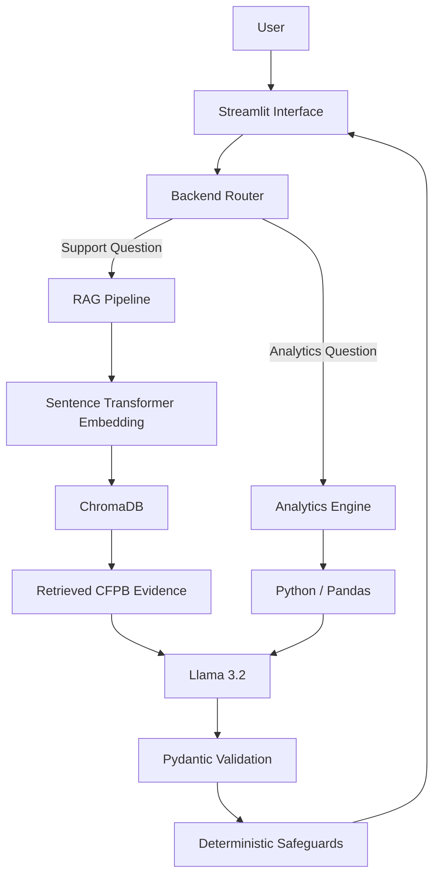

# CFPB Consumer Complaint Intelligence & Support Assistant

## Project Overview

The CFPB Consumer Complaint Intelligence & Support Assistant is an AI-powered consumer-finance support and analytics application developed for the **DSA5202 – Special Topics in Data Science** final project.

The system combines:

- Retrieval-Augmented Generation (RAG)
- Large Language Models
- Semantic document retrieval
- Structured CFPB complaint data
- Deterministic Python analytics
- Schema validation
- Multi-turn conversation support
- Streamlit
- Docker containerization

The application is designed to help users understand consumer-finance complaints using official Consumer Financial Protection Bureau (CFPB) information while also providing analytical insights into complaint patterns.

It is not intended to provide legal, financial or regulatory advice.

---

## Problem Statement

Consumers frequently experience problems involving financial products such as credit reporting, debt collection, bank accounts, loans and credit cards.

Although the CFPB provides official information and maintains a large public Consumer Complaint Database, users may find it difficult to:

- locate relevant guidance;
- understand complaint procedures;
- interpret financial complaint terminology;
- identify patterns in millions of complaint records; and
- determine what practical steps may be appropriate.

The project addresses this problem through an AI system that combines official CFPB guidance with structured complaint analytics.

---

## Main Capabilities

The application provides two primary capabilities.

### 1. Consumer Complaint Support

Users can describe a consumer-finance problem in natural language.

The system:

1. interprets the user's request;
2. retrieves relevant information from official CFPB documents;
3. classifies the complaint into a CFPB product category;
4. generates a grounded summary;
5. provides a practical recommended action;
6. indicates whether relevant evidence was found; and
7. flags cases that may require human review.

Example:

> There is an account on my credit report that is not mine. What should I do?

---

### 2. Complaint Data Analytics

Users can also ask statistical questions about CFPB complaint data.

Examples include:

> How many complaints were published in 2025?

> Which product had the most complaints?

> Which month recorded the highest number of complaints?

> What percentage of complaints received timely responses?

Analytical calculations are performed using deterministic Python and Pandas operations rather than asking the language model to calculate statistics.

The language model is used only to explain the computed result in natural language.

---

## Dataset

The project uses the official **CFPB Consumer Complaint Database**.

The original raw dataset contained millions of records and was approximately 5.4 GB.

For this project, complaints published in the CFPB database for **2025** were processed.

### 2025 Dataset Summary

| Metric | Value |
|---|---:|
| Published complaints | 5,442,951 |
| Development sample | 108,809 |
| Financial products | 11 |
| Unique issues | 90 |
| Companies | 3,968 |
| Timely responses | 99.55% |
| Highest complaint month | October 2025 |
| October complaints | 519,784 |

The structured statistical analyses use aggregated results derived from the full **5,442,951 published complaint records**.

The 108,809-record sample is used as a manageable development and inspection subset.

---

## Knowledge Base

The Retrieval-Augmented Generation component uses official CFPB documents stored in:

```text
data/documents/
```

The knowledge base includes CFPB information relating to:

- consumer complaint procedures;
- company complaint handling;
- credit report disputes;
- debt collection;
- suspicious account activity; and
- the CFPB 2025 Consumer Response Annual Report.

Documents are processed by `build_knowledge_base.py`.

The pipeline performs:

```text
PDF documents
      ↓
Text extraction
      ↓
Text cleaning
      ↓
Chunking
      ↓
Sentence Transformer embeddings
      ↓
ChromaDB vector storage
```

The current knowledge base contains approximately **252 document chunks**.

---

## Retrieval-Augmented Generation Architecture

The system uses the `all-MiniLM-L6-v2` Sentence Transformer model for document embeddings.

ChromaDB is used as the vector database.

For a consumer-support query:

```text
User Question
      ↓
Query Embedding
      ↓
ChromaDB Similarity Search
      ↓
Relevant CFPB Chunks
      ↓
Grounded Prompt
      ↓
Llama 3.2
      ↓
Pydantic Validation
      ↓
Deterministic Safeguards
      ↓
Final Response
```

Retrieval thresholds are used to prevent weak or irrelevant evidence from being treated as reliable CFPB guidance.

---

## System Architecture



---

## Technology Stack

### Application

- Python 3.11
- Streamlit

### Large Language Model

- Llama 3.2
- Ollama

### Retrieval

- ChromaDB
- Sentence Transformers
- `all-MiniLM-L6-v2`

### Data Processing

- Pandas
- NumPy

### Document Processing

- PyPDF

### Validation

- Pydantic

### Deployment

- Docker
- Docker Compose

---

## Prompt Engineering

Three initial prompt variants were evaluated.

### Variant A – Basic Prompt

A minimal structured prompt providing general instructions.

### Variant B – Strict Grounding Prompt

A stricter prompt emphasizing evidence use and reduced hallucination.

### Variant C – Evidence-Aware Prompt

A balanced prompt emphasizing:

- CFPB evidence;
- uncertainty;
- complaint classification;
- factual summaries;
- practical actions;
- human review; and
- controlled verbosity.

Variant C produced the strongest overall performance and was selected as the final prompt.

### Initial Prompt Evaluation

| Prompt | Product Accuracy | Structured Validity | Human Review Consistency |
|---|---:|---:|---:|
| A – Basic | 60.0% | 100% | 93.3% |
| B – Strict Grounding | 73.3% | 100% | 100% |
| C – Evidence Aware | 80.0% | 100% | 100% |

Additional prompt refinements were tested but did not consistently improve performance.

This showed that adding more prompt instructions did not necessarily improve the local Llama model.

Consequently, some predictable safety and routing behaviours were moved from prompting into deterministic Python logic.

---

## Structured Output

Consumer-support responses use a structured schema containing fields such as:

- product;
- summary;
- recommended action;
- evidence availability; and
- human review.

Pydantic validates the generated response before it is shown to the user.

This reduces malformed or unpredictable language-model output.

---

## Deterministic Safeguards

The project intentionally separates tasks that should be performed by deterministic code from tasks suited to language models.

Examples include:

- complaint counting;
- percentages;
- highest and lowest values;
- monthly aggregation;
- product statistics;
- query routing;
- selected complaint classifications;
- evidence thresholds; and
- unsupported calculation detection.

This architecture reduces unnecessary dependence on the LLM.

---

## Multi-Turn Conversation

The Streamlit application maintains conversation history during a user session.

This allows contextual follow-up questions.

Example:

```text
User:
There is an account on my credit report that is not mine.

Assistant:
Provides grounded CFPB guidance.

User:
What should I do next?

Assistant:
Uses the previous conversation context when interpreting
the follow-up question.
```

The interface also provides a conversation reset capability.

---

## Reliability Evaluation

A formal evaluation suite was created with **15 test cases** covering:

- normal consumer-support requests;
- credit reporting;
- debt collection;
- bank account problems;
- out-of-domain queries;
- ambiguous queries;
- invalid/gibberish inputs;
- adversarial requests;
- analytics queries;
- unsupported calculations; and
- multi-turn interaction.

Final evaluation results:

| Metric | Result |
|---|---:|
| Test cases | 15 |
| Passed | 15 |
| Failed | 0 |
| Overall pass rate | 100% |
| Route accuracy | 100% |
| Structured output validity | 100% |

Evaluation files are stored in:

```text
evaluation/formal_evaluation/
```

---

## Unit Testing

Backend unit tests are located in:

```text
tests/test_backend.py
```

The current test suite contains **12 tests** covering functionality including:

- analytics routing;
- support routing;
- phrase matching;
- contextual follow-ups;
- complaint product detection;
- debt-collection safeguards;
- human-review behaviour;
- complaint totals;
- monthly analytics; and
- unsupported calculations.

Latest result:

```text
Ran 12 tests

OK
```

---

## Project Structure

```text
customer-service-ai-clean/
│
├── backend.py
├── streamlit_app.py
├── main.py
├── formal_evaluation.py
├── prepare_cfpb_data.py
├── build_knowledge_base.py
├── requirements.txt
├── Dockerfile
├── docker-compose.yml
├── .dockerignore
├── .env.example
├── .gitignore
│
├── data/
│   ├── documents/
│   ├── processed/
│   ├── raw/
│   └── chroma_db/
│
├── evaluation/
│   ├── formal_evaluation/
│   └── prompt_experiments/
│
└── tests/
    └── test_backend.py
```

The large raw CFPB dataset and generated ChromaDB files are excluded from Git using `.gitignore`.

---

## Installation

### 1. Clone the Repository

```bash
git clone https://github.com/oheneba-oa/Final_Project.git
cd Final_Project
```

---

### 2. Create or Activate a Python Environment

Python 3.11 is recommended.

Example using Conda:

```bash
conda create -n customer_service_ai python=3.11
conda activate customer_service_ai
```

---

### 3. Install Dependencies

```bash
python -m pip install -r requirements.txt
```

---

## Ollama Setup

Install Ollama and ensure the Llama 3.2 model is available.

```bash
ollama pull llama3.2
```

Check installed models:

```bash
ollama list
```

---

## Environment Configuration

Copy:

```text
.env.example
```

to:

```text
.env
```

Example configuration:

```text
OLLAMA_HOST=http://localhost:11434
HF_TOKEN=
```

The Hugging Face token is optional.

---

## Building the Knowledge Base

If the ChromaDB database has not already been generated, ensure the CFPB documents are available in:

```text
data/documents/
```

Then run:

```bash
python build_knowledge_base.py
```

This creates the local vector database in:

```text
data/chroma_db/
```

---

## Preparing CFPB Structured Data

The original CFPB CSV is intentionally excluded from the repository because of its size.

To rebuild the structured data, place the original file at:

```text
data/raw/complaints.csv
```

Then run:

```bash
python prepare_cfpb_data.py
```

The generated analytical files are written to:

```text
data/processed/
```

---

## Running the Application Locally

Start Ollama first.

Then run:

```bash
streamlit run main.py
```

Open:

```text
http://localhost:8501
```

in a browser.

---

## Running the Tests

```bash
python -m unittest discover -s tests -v
```

---

## Running the Formal Evaluation

```bash
python formal_evaluation.py
```

Evaluation outputs are saved in:

```text
evaluation/formal_evaluation/
```

---

## Docker Deployment

The application has been successfully built and tested using Docker Desktop.

### Build the Docker Image

```bash
docker compose build
```

The Docker image uses CPU-only PyTorch to avoid unnecessary CUDA and NVIDIA dependencies.

### Start the Application

Ensure Ollama is running on the host computer.

Then run:

```bash
docker compose up
```

Open:

```text
http://localhost:8501
```

The Docker container connects to the host Ollama service using:

```text
host.docker.internal
```

### Stop the Application

Press:

```text
Ctrl + C
```

and then run:

```bash
docker compose down
```

---

## Docker Architecture

```text
Windows Host
│
├── Ollama
│   └── Llama 3.2
│
└── Docker Desktop
    │
    └── Application Container
        ├── Python 3.11
        ├── Streamlit
        ├── Backend
        ├── Sentence Transformers
        ├── ChromaDB
        └── Processed CFPB Data
```

The model is not packaged inside the application image.

This keeps the project simpler and avoids unnecessarily large Docker images.

---

## Error and Uncertainty Handling

The application includes safeguards for:

- weak retrieval results;
- insufficient CFPB evidence;
- ambiguous questions;
- malformed LLM output;
- unsupported calculations;
- out-of-domain questions;
- adversarial requests; and
- cases requiring human review.

The application avoids claiming guaranteed consumer outcomes.

---

## Limitations

The current system has several limitations.

1. It uses a local Llama 3.2 model whose output can vary between runs.

2. The knowledge base only covers the CFPB documents included in the project.

3. The system does not provide legal advice.

4. Complaint statistics currently focus primarily on the processed 2025 dataset.

5. The application depends on a locally available Ollama service.

6. Retrieval performance depends on the quality and coverage of the indexed CFPB documents.

7. Some safety and reliability behaviours require deterministic rules because prompt instructions alone are not always consistently followed by the model.

---

## Future Improvements

Future versions could include:

- additional CFPB publications;
- support for multiple complaint years;
- automatic updating of CFPB complaint data;
- improved retrieval reranking;
- additional financial-product classifications;
- cloud-hosted language models;
- persistent user sessions;
- database-backed conversation storage;
- richer visual analytics dashboards; and
- automated monitoring of model and retrieval performance.

---

## Responsible Use

The system is designed as an informational and decision-support tool.

It should not be used as a replacement for:

- qualified legal advice;
- professional financial advice;
- direct communication with a financial institution; or
- official CFPB guidance.

When evidence is incomplete or confidence is low, the application is designed to indicate uncertainty and recommend human review.

---

## Author

**Oheneba Adu Oduro-Asare**