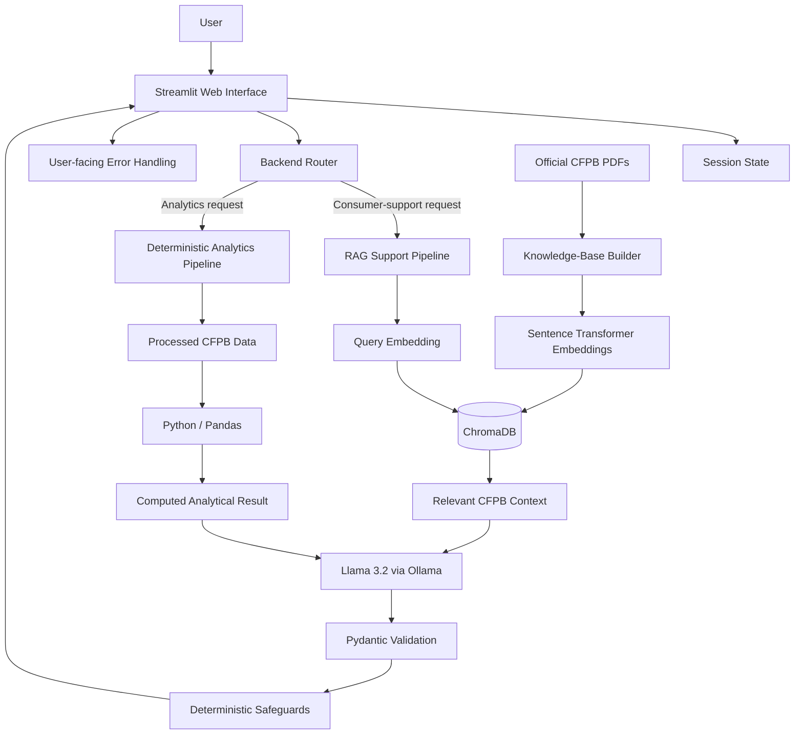

# System Architecture

## Overview

The CFPB Consumer Complaint Intelligence & Support Assistant uses a hybrid AI architecture designed to combine natural-language understanding with deterministic software, retrieval and validation.

The system is intentionally not implemented as a free-running chatbot or autonomous agent.

Instead, each type of task is assigned to the component best suited to perform it reliably.

The main architectural principle is:

```text
Numerical analysis
    → Python / Pandas

Knowledge retrieval
    → Sentence Transformers + ChromaDB

Natural-language interpretation and explanation
    → Llama 3.2

Structured output validation
    → Pydantic

Routing, thresholds and predictable safeguards
    → Deterministic Python logic
```

This separation reduces unnecessary dependence on the language model and makes the application easier to test, explain and maintain.

---

## Architecture Goals

The architecture was designed around five goals:

1. **Grounded responses**
   Consumer-support answers should use relevant CFPB information instead of relying entirely on the model's pre-trained knowledge.

2. **Reliable analytics**
   Numerical results should be calculated using deterministic software rather than generated by an LLM.

3. **Controlled AI behaviour**
   Model output should be validated and subjected to application-level safeguards.

4. **Explainability**
   A user request should be traceable from the interface through routing, retrieval or analysis, validation and final presentation.

5. **Reproducibility**
   Another developer should be able to configure, rebuild and run the system locally or with Docker.

---

## High-Level Architecture



---

## Major Components

### 1. Streamlit User Interface

`streamlit_app.py` provides the web interface.

Its responsibilities include:

- receiving user questions;
- displaying conversation history;
- showing analytical and support responses;
- displaying retrieval evidence;
- exposing validated structured output where appropriate;
- presenting system status and error messages; and
- allowing the current conversation to be reset.

Streamlit was selected because it provides a lightweight Python-native interface suitable for rapid development while still supporting a professional web experience.

---

### 2. Application Entry Point

`main.py` is the application entry point.

It performs:

- environment loading;
- logging configuration;
- application startup; and
- top-level startup error handling.

The top-level error boundary prevents startup failures from being exposed as uncontrolled application crashes.

---

### 3. Backend Router

The backend router determines which processing path should handle a request.

The two primary routes are:

```text
consumer_support
```

and:

```text
data_analysis
```

The router uses controlled application logic rather than allowing the LLM to freely decide which functions to execute.

This makes routing behaviour easier to test and reduces unpredictable tool selection.

---

## Consumer-Support Request Flow

A consumer-support request follows this path:

```text
User enters complaint question
        ↓
Streamlit interface
        ↓
Conversation context is collected
        ↓
Backend router identifies support intent
        ↓
Question is embedded
        ↓
ChromaDB similarity search
        ↓
Relevant CFPB chunks retrieved
        ↓
Retrieval quality checked
        ↓
Grounded prompt constructed
        ↓
Llama 3.2 generates structured assessment
        ↓
Pydantic validates output
        ↓
Deterministic safeguards applied
        ↓
Final answer and evidence displayed
```

Example:

```text
User:
"I found an account on my credit report that I do not recognize.
What should I do?"
```

The system does not simply send this question directly to the model.

It first searches the CFPB knowledge base for relevant evidence and uses the retrieved context when generating the response.

---

## Data-Analysis Request Flow

Analytics questions follow a different path.

```text
User asks statistical question
        ↓
Backend router identifies analytics intent
        ↓
Requested metric is interpreted
        ↓
Approved deterministic analytics function runs
        ↓
Python / Pandas calculates the result
        ↓
Computed value returned
        ↓
Llama 3.2 may explain the result in natural language
        ↓
Final response displayed
```

For example:

```text
User:
"Which month had the highest number of complaints in 2025?"
```

Python calculates:

```text
October 2025
519,784 complaints
```

The LLM is not responsible for calculating that number.

Its role is limited to explaining an already-computed result.

This design reduces numerical hallucination.

---

# Retrieval-Augmented Generation Architecture

## Source Documents

The knowledge base uses official CFPB documents stored in:

```text
data/documents/
```

The current document set covers:

- consumer complaint procedures;
- company complaint handling;
- credit-report disputes;
- debt collection;
- suspicious account activity; and
- the CFPB 2025 Consumer Response Annual Report.

---

## Knowledge-Base Construction

`build_knowledge_base.py` performs the ingestion process.

```text
CFPB PDF documents
        ↓
PDF text extraction
        ↓
Whitespace and text cleaning
        ↓
Document chunking
        ↓
Metadata assignment
        ↓
Sentence Transformer encoding
        ↓
ChromaDB storage
```

The current knowledge base contains approximately:

```text
252 chunks
```

---

## Chunking Strategy

Documents are divided into chunks of approximately:

```text
120 words
```

with an overlap of approximately:

```text
20 words
```

The overlap helps preserve context where information crosses chunk boundaries.

The chunk size was kept relatively small because the source documents contain procedural and informational sections where focused retrieval is more useful than returning very large document segments.

---

## Embedding Model

The embedding model is:

```text
all-MiniLM-L6-v2
```

from Sentence Transformers.

It converts both document chunks and user queries into numerical vector representations.

These vectors allow semantically related information to be located even when the user's wording differs from the source document.

---

## Vector Storage

ChromaDB provides persistent local vector storage.

The generated database is stored in:

```text
data/chroma_db/
```

The generated Chroma database is excluded from Git because it can be reproduced from the CFPB source documents.

---

## Similarity Retrieval

At query time:

```text
User question
      ↓
Sentence Transformer
      ↓
Query embedding
      ↓
ChromaDB similarity search
      ↓
Candidate CFPB chunks
```

The application applies retrieval thresholds before treating the returned evidence as reliable.

Current thresholds include:

```text
Maximum accepted top distance:   0.50
Maximum accepted chunk distance: 0.52
```

These thresholds help prevent weak or unrelated retrieved text from being presented as supporting evidence.

---

## Why Retrieval Is Preferred to Sending Every Document to the LLM

The system uses retrieval rather than placing the entire CFPB document collection into every prompt.

Sending every document would:

- include large amounts of irrelevant information;
- increase prompt size;
- make the source of an answer harder to identify;
- reduce scalability as more documents are added; and
- make it harder to reject weak evidence.

Retrieval instead allows the application to:

```text
find relevant information
        ↓
select a small amount of context
        ↓
provide that context to the LLM
```

This makes grounding more targeted and allows the application to indicate when suitable evidence cannot be found.

---

# Large Language Model

## Model

The application uses:

```text
Llama 3.2
```

through:

```text
Ollama
```

Ollama runs outside the application process as a local model service.

The application communicates with it through the configured Ollama host.

---

## Role of the LLM

The LLM is used for:

- understanding natural-language requests;
- interpreting consumer complaint descriptions;
- generating concise grounded summaries;
- producing practical explanations;
- converting deterministic analytical results into readable language; and
- maintaining conversational continuity where appropriate.

It is deliberately not used for:

- calculating complaint totals;
- calculating percentages;
- determining maximum or minimum values;
- storing application state;
- validating its own structured output; or
- determining whether retrieved evidence satisfies fixed similarity thresholds.

---

# Prompt Management

The support prompt instructs the model to:

- prioritize retrieved CFPB evidence;
- avoid inventing CFPB procedures or requirements;
- distinguish consumer statements from supporting evidence;
- acknowledge insufficient evidence;
- classify complaints using CFPB product categories;
- use uncertainty when confidence is insufficient;
- provide concise factual summaries;
- avoid guaranteed legal or financial outcomes;
- trigger human review where necessary; and
- avoid generating or modifying unverified URLs.

Three major prompt approaches were evaluated before selecting the final design.

The experiment results are retained under:

```text
evaluation/prompt_experiments/
evaluation/prompt_refinement/
evaluation/prompt_final/
```

Prompt behaviour was not treated as the only safety mechanism.

Where predictable behaviour was required, the project moved that behaviour into deterministic application logic.

---

# Structured Output and Validation

Consumer-support responses use a structured assessment rather than unrestricted free text.

Important fields include:

```text
product
summary
recommended_action
evidence_available
human_review
```

Pydantic is used to validate the expected structure.

The processing path is:

```text
LLM output
    ↓
Structured parsing
    ↓
Pydantic validation
    ↓
Application safeguards
    ↓
User response
```

This prevents the application from blindly trusting arbitrary model-generated values.

---

# Deterministic Safeguards

After model output is validated, deterministic safeguards apply additional predictable rules.

Examples include:

- weak-evidence handling;
- human-review escalation;
- selected product-classification corrections;
- unrecognized-debt safeguards;
- unsupported analytics detection;
- evidence-distance thresholds; and
- removal of unverified model-generated URLs.

This architecture reflects the principle that deterministic software should enforce behaviour that must remain predictable.

---

# Tools and Controlled Capabilities

The application implements two meaningful operational capabilities.

## Capability 1: CFPB Knowledge Retrieval

Used for questions requiring consumer-finance guidance.

```text
User question
      ↓
Semantic retrieval
      ↓
Relevant official evidence
      ↓
Grounded interpretation
```

---

## Capability 2: Deterministic CFPB Analytics

Used for questions requiring numerical analysis.

Supported operations include examples such as:

- complaint totals;
- product rankings;
- issue rankings;
- percentages;
- monthly comparisons;
- company counts;
- channel analysis;
- state-level aggregation; and
- timely-response calculations.

```text
User question
      ↓
Analytics routing
      ↓
Python / Pandas operation
      ↓
Verified result
```

The router determines which capability should handle the user's request.

The system therefore uses controlled orchestration rather than unrestricted autonomous tool execution.

---

# Application State and Conversation Memory

Conversation memory is maintained using:

```text
Streamlit session state
```

During a session, the application stores messages containing:

```text
user messages
assistant messages
```

Previous messages can then be supplied as context for follow-up questions.

Example:

```text
User:
"I found an account on my credit report that is not mine."

Assistant:
Provides grounded credit-report guidance.

User:
"What should I do next?"
```

The second question can be interpreted using the first interaction.

---

## Reset Behaviour

The user interface provides a reset capability.

Resetting the session clears the current conversational history and starts a new conversation context.

---

## Memory Scope

Conversation memory is:

```text
session-based
```

It is not stored permanently in an external database.

This was an intentional simplification for the current version.

Future versions could use persistent conversation storage if required.

---

# Persistent Storage

The application uses multiple forms of storage for different purposes.

## CFPB Source Documents

```text
data/documents/
```

Stores the official CFPB PDF sources used to build the knowledge base.

---

## ChromaDB

```text
data/chroma_db/
```

Stores generated vector embeddings and retrieval metadata.

It is persistent locally but reproducible from the source documents.

---

## Processed Structured Data

```text
data/processed/
```

Stores aggregated CFPB complaint data used by deterministic analytics.

---

## Raw Dataset

```text
data/raw/
```

The original multi-gigabyte CFPB complaint CSV is kept locally and excluded from Git.

The submitted repository contains the processed analytical outputs required by the running application.

---

# Error-Handling Boundaries

The application uses error handling at several levels.

## Request-Level Boundary

The main Streamlit request-processing workflow is protected by exception handling.

If a request cannot be completed, the interface presents a user-facing message rather than exposing an uncontrolled traceback.

Possible failures include:

- unavailable Ollama service;
- model execution failure;
- retrieval failure;
- structured-output failure;
- unexpected processing errors; and
- tool or analytics failures.

---

## Startup Boundary

`main.py` provides a top-level startup failure boundary.

Failures such as unavailable required application data are:

```text
logged
      ↓
converted to a clear user-facing error
      ↓
application execution stopped safely
```

---

## Retrieval Uncertainty Boundary

Weak retrieval is treated separately from technical failure.

If appropriate evidence cannot be found, the system does not pretend that CFPB support exists.

Instead, it can:

- indicate insufficient evidence;
- return a safe fallback;
- mark evidence as unavailable; and
- request human review.

---

# Logging

Python logging is configured in:

```text
main.py
```

Logging provides operational information and records startup failures using exception logging.

This supports diagnosis without exposing technical stack traces directly to the end user.

---

# External Services

## Ollama

Ollama is the primary external runtime service.

```text
Application
    ↓
OLLAMA_HOST
    ↓
Ollama
    ↓
Llama 3.2
```

During local development:

```text
OLLAMA_HOST=http://localhost:11434
```

During Docker execution:

```text
OLLAMA_HOST=http://host.docker.internal:11434
```

The language model is therefore not packaged inside the application container.

---

## Hugging Face

The Sentence Transformer model may be downloaded through Hugging Face when it is not already available locally.

An optional:

```text
HF_TOKEN
```

can be configured for authenticated model downloads.

The application does not require a Hugging Face token for normal unauthenticated access where permitted.

---

# Docker Architecture

The deployment architecture is:

```text
Windows Host
│
├── Ollama
│   └── Llama 3.2
│
└── Docker Desktop
    │
    └── CFPB Application Container
        ├── Python 3.11
        ├── Streamlit
        ├── Application Backend
        ├── Sentence Transformers
        ├── ChromaDB
        └── Processed CFPB Data
```

Docker Compose maps:

```text
Host port 8501
        ↓
Container port 8501
```

and allows the application container to access host Ollama through:

```text
host.docker.internal
```

---

# Fresh-Clone Knowledge-Base Reproduction

The generated Chroma database is excluded from the repository.

On Docker startup, the application checks for:

```text
data/chroma_db/chroma.sqlite3
```

If the database is not available, Docker runs:

```bash
python build_knowledge_base.py
```

before starting Streamlit.

The process is therefore:

```text
Container starts
        ↓
Check for Chroma database
        ↓
Database present?
   ├── Yes → Start application
   │
   └── No
        ↓
   Load embedding model
        ↓
   Process CFPB PDFs
        ↓
   Build ChromaDB
        ↓
   Start application
```

A fresh-container test successfully:

- detected the missing knowledge base;
- processed all six CFPB source documents;
- created 252 chunks;
- started Streamlit; and
- successfully handled a grounded consumer-support query.

---

# Data Preparation Architecture

The original CFPB complaint export is approximately 5.4 GB.

Rather than loading this raw dataset during each user request, preprocessing is performed separately.

`prepare_cfpb_data.py`:

```text
Raw CFPB CSV
      ↓
Chunked reading
      ↓
Header normalization
      ↓
2025 filtering
      ↓
Cleaning
      ↓
Deterministic aggregation
      ↓
Processed CSV files
```

The resulting files include:

```text
summary_metrics.csv
complaints_by_product.csv
complaints_by_issue.csv
complaints_by_company.csv
complaints_by_response.csv
complaints_by_channel.csv
complaints_by_state.csv
complaints_by_month.csv
timely_response_by_product.csv
cfpb_2025_sample.csv
```

This avoids repeatedly processing millions of records during interactive use.

---

# Design Decisions and Justification

## Why Python and Pandas for Analytics?

Complaint totals, percentages and rankings are deterministic computations.

Python and Pandas provide reproducible results and are more reliable for these operations than an LLM.

---

## Why RAG?

The model's internal knowledge cannot guarantee access to the exact CFPB information required by the project.

RAG allows responses to be grounded in the documents included in the knowledge base.

---

## Why ChromaDB?

ChromaDB provides lightweight local vector storage that integrates directly with Python and Sentence Transformers.

It is appropriate for the scale of the project's document collection without requiring additional database infrastructure.

---

## Why `all-MiniLM-L6-v2`?

The model provides compact sentence embeddings suitable for semantic similarity retrieval while remaining practical for local execution.

---

## Why Llama 3.2?

Llama 3.2 can run locally through Ollama and supports the language-understanding and explanation tasks required by the project without requiring a hosted proprietary model service.

---

## Why Pydantic?

Pydantic creates an explicit contract between generated model output and the application.

This allows malformed or incomplete responses to be detected before they are trusted.

---

## Why Deterministic Safeguards?

Prompt instructions alone did not always produce consistent behaviour during experimentation.

Predictable safety or routing requirements were therefore implemented in Python where appropriate.

This was a deliberate engineering decision based on observed model behaviour.

---

## Why Session-Based Memory?

Permanent user-memory storage is not required for the current problem.

Streamlit session state provides enough conversational context for follow-up questions while keeping the current architecture simple and privacy-conscious.

---

## Why Host-Based Ollama?

Packaging the LLM inside the application image would significantly increase container size and deployment complexity.

Running Ollama on the host keeps the application container smaller while preserving local model execution.

---

# Reliability and Evaluation

Reliability is tested using two complementary approaches.

## Unit Tests

The backend contains 12 unit tests covering:

- routing;
- contextual follow-up behaviour;
- phrase matching;
- product detection;
- safety safeguards;
- analytics calculations; and
- unsupported operations.

---

## Formal Evaluation

The formal evaluation contains 15 representative cases including:

- normal support requests;
- ambiguous requests;
- invalid input;
- out-of-domain requests;
- adversarial requests;
- expected retrieval;
- expected analytics routing;
- unsupported calculations; and
- multi-turn conversation.

The final validated run achieved:

```text
15 / 15 cases passed

Overall pass rate:
100%

Route accuracy:
100%

Structured-output validity:
100%
```

These figures describe performance on the defined evaluation set and are not presented as proof of perfect performance on every possible real-world input.

---

# Known Limitations

The current architecture has several limitations.

1. Llama 3.2 output may vary between runs.

2. Retrieval is limited to the CFPB documents included in the project.

3. Complaint analytics currently focus on the processed 2025 data.

4. The application requires a running Ollama service.

5. Conversation state is not persistent between sessions.

6. Retrieval performance depends on document coverage and chunk relevance.

7. The system does not provide professional legal or financial advice.

8. The application does not submit complaints or take actions on behalf of the consumer.

9. Some reliability behaviours still require explicit deterministic rules because model behaviour is probabilistic.

---

# Request Trace for Technical Defence

A complete consumer-support request can be explained as:

```text
1. User enters a complaint in Streamlit.

2. Streamlit gathers the current question and relevant
   conversation history.

3. The backend router classifies the request as
   consumer support.

4. The question is embedded using all-MiniLM-L6-v2.

5. ChromaDB performs semantic similarity retrieval.

6. The backend checks retrieval distances.

7. Accepted CFPB chunks are placed into the grounded prompt.

8. Llama 3.2 generates a structured assessment.

9. Pydantic validates the assessment.

10. Deterministic safeguards apply predictable safety rules.

11. Streamlit displays the answer, evidence status,
    human-review status and source information.
```

A complete analytics request can be explained as:

```text
1. User enters a statistical question.

2. The router identifies the analytics route.

3. Python determines the supported analytical operation.

4. Pandas calculates the answer from processed CFPB data.

5. The computed result is fixed before LLM explanation.

6. Llama 3.2 converts the result into readable language.

7. Streamlit displays the final response.
```

---

# Executive Interpretation

At a nontechnical level, the architecture solves two different problems with two different methods.

```text
Need guidance?
    → Find relevant official CFPB information
    → Use AI to explain it clearly

Need a number?
    → Calculate it from the CFPB data
    → Use AI only to explain the result
```

This distinction is central to the project.

The system does not treat AI as the answer to every problem.

Instead, AI is one component within a controlled software architecture that also uses retrieval, deterministic computation, validation, testing and human oversight.